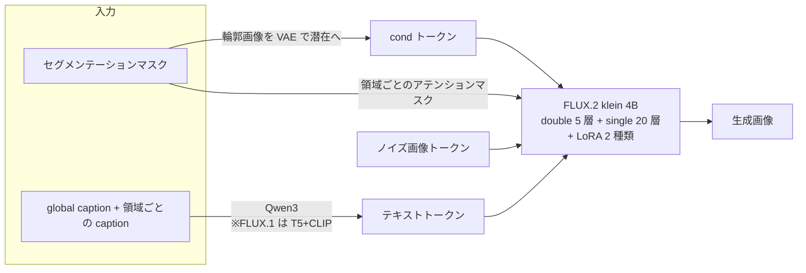

# 進捗報告：Seg2Any の基盤を FLUX.2 [klein] 4B に置き換えた

2026-10-09 ミーティング用（作業期間：2026-10-06 〜 10-08）

---

## 0. 結論（最初に話すこと）

1. **Seg2Any の基盤モデルを FLUX.1-dev（12B）から FLUX.2 [klein] 4B に置き換えた。** transformer・推論パイプライン・学習スクリプトを FLUX.2 用に作り直し、UEC-Ramen555 で LoRA を学習し直した。
2. **マスクへの忠実さは FLUX.1 と統計的に同等**（val 55 枚、境界 recall 0.772 vs 0.808、p = 0.07）。**元写真への近さ（CLIP-I）は FLUX.1 より +3.8 高い**。
3. **約 3 倍速く、GPU メモリは約半分**（17.8 → 6.3 秒/枚、31.6 → 17.3 GB）。
4. 同じ仕組みで **UECFoodPix（定食）** と **SACap-1M（一般画像）** にも学習を広げた。

*UEC-Ramen555 val。左から マスク | 元写真 | FLUX.1-dev + LoRA | FLUX.2 Base + LoRA（50 step）| FLUX.2 蒸留版 + LoRA（4 step）。同じマスク・同じ seed。*

---

## 1. 背景と目的

- これまで Seg2Any（セグメンテーションマスクと領域ごとの説明文から画像を生成する手法）を FLUX.1-dev の上で使い、UEC-Ramen555 で LoRA を学習していた（2026-07〜）。
- FLUX.1-dev は 12B と重く、1 枚 18 秒ほどかかる。**FLUX.2 [klein] 4B** は 3 分の 1 の規模で、テキストエンコーダも新しい（Qwen3）。
- **目的：品質を落とさずに軽く・速くする。** あわせて、新しい基盤で他のデータセットにも広げられるか確かめる。

---

## 2. やったことの一覧

| 日付 | 内容 | 結果 |
|---|---|---|
| 10/6 | FLUX.2 用の環境を作る（torch 2.8 cu128、diffusers 0.41） | gp42（Blackwell）でも動く |
| 10/6 | transformer・推論・学習スクリプトを FLUX.2 用に作り直す | テスト 19 項目すべて通過 |
| 10/6 | UEC-Ramen555 で LoRA を学習（3000 step、8 GPU で約 1 時間） | 学習できた |
| 10/7 | 境界が甘い原因を調べ、CFG の組み方を直す | 境界 recall 0.563 → 0.772 |
| 10/7 | val 55 枚で FLUX.1 と定量比較 | 境界は同等、元写真への近さは FLUX.2 が上 |
| 10/7 | **UECFoodPix（定食 9000 枚）** で学習（5500 step） | 皿マスクを足した版で背景が自然になった |
| 10/7 | **SACap-1M** で試し学習（1 万枚、1024²、2000 step） | LoRA なしより明らかに領域に沿う |
| 10/8 | Ramen LoRA を学習し直し（v2） | 10 例で境界 recall 0.772 → 0.925 |

FLUX.1 版のファイルには手を入れず、FLUX.2 版は新しいファイルとして作った。両方をいつでも比べられる。

---

## 3. 移植で変えたところ

FLUX.1 と FLUX.2 は同じ MM-DiT 系だが、中身はかなり違う。Seg2Any の仕組み（輪郭の cond トークン、領域ごとのアテンションマスク、2 種類の LoRA）はそのまま残し、FLUX.2 の構造に合わせて作り直した。

| 項目 | FLUX.1-dev | FLUX.2 klein 4B | 対応 |
|---|---|---|---|
| 規模 | 12B（19 + 38 層） | **4B（5 + 20 層）** | 強いマスクを掛ける層の範囲を同じ比率に換算 |
| テキストエンコーダ | T5-XXL + CLIP | **Qwen3**（pooled なし） | テキスト処理を作り直し |
| テキストの位置 ID | すべて 0 | トークン番号あり | **caption ごとに 0 から振り直す** |
| 画像の位置 ID | 3 軸 | **4 軸** | 4 軸に対応 |
| VAE | 16ch | **32ch**（新しい正規化） | klein 純正の処理を使う |
| 変調（AdaLN） | ブロックごと | **全体で共有** | cond 用の変調を先頭で作って配る |
| guidance | 埋め込みあり | Base 版は true CFG、蒸留版は CFG なし | パイプラインで切り替え |

**確かめ方**：LoRA を付けない状態で純正の FLUX.2 と出力が一致すること、学習と推論で同じ入力になることなど、19 項目のテストを書いて全部通した。

---

## 4. 結果 ①：UEC-Ramen555

### 4.1 見つけた問題：境界が FLUX.1 より甘い → 原因は CFG

最初の学習結果は見た目は良いが、**具材の輪郭がマスクの境界からずれやすかった**。

原因は **CFG のネガティブ側にも輪郭（cond）を入れていたこと**。CFG は「ポジティブの予測 − ネガティブの予測」を強調する。両方に同じ輪郭を入れると、輪郭の効果が差に入らず、**テキストだけが強調されて輪郭は強調されない**。ネガティブ側から輪郭を外すと、輪郭も一緒に強調される。

*左から CFG なし / CFG 4（ネガティブにも輪郭あり＝旧設定）/ CFG 4（ネガティブから輪郭を外す＝新設定）。それぞれ「生成画像」と「マスク境界（赤線）を重ねたもの」。新設定では丼の縁やチャーシューの輪郭が赤線に沿う。*

| 設定（10 例、20 step） | 境界 recall ↑ | 秒/枚 |
|---|---|---|
| 元写真（参考） | 0.590 | – |
| FLUX.1-dev + LoRA | 0.843 | – |
| FLUX.2、CFG なし | 0.484 | 3.5 |
| FLUX.2、CFG 4（旧設定） | 0.646 | 7.4 |
| **FLUX.2、CFG 4（新設定）** | **0.838** | **6.3** |

> **境界 recall**：マスクの境界画素のうち、生成画像のエッジ（Canny）が 3px 以内にある割合。元写真は境界がぼけていたりアノテーションが粗かったりするので、生成画像の方が高くなりうる。

CFG の強さを変えた一覧（クリックで開く）

### 4.2 val 55 枚での定量評価

学習に使っていない val 55 枚すべてで比べた。

| 条件 | 境界 recall ↑ | CLIP-T ↑ | CLIP-I ↑ | KID×1000 ↓ |
|---|---|---|---|---|
| FLUX.1-dev + LoRA | **0.808** | 28.0 | 85.3 | 18.8 |
| FLUX.2 Base（旧 CFG） | 0.563 | 27.9 | 88.9 | 17.4 |
| **FLUX.2 Base（新 CFG）** | 0.772 | 28.1 | **89.1** | 17.9 |
| FLUX.2 蒸留版 4 step | 0.592 | 28.4 | 85.5 | 44.4 |

- **境界**：新 CFG は旧 CFG より +0.21（p = 6e-24）。FLUX.1 との差 −0.035 は **有意ではない**（p = 0.07、55 枚中 23 枚では FLUX.1 を上回る）。
- **CLIP-T**（caption に沿っているか）：どの条件も差なし。
- **CLIP-I**（元写真に近い見た目か）：**FLUX.2 は FLUX.1 より +3.8 高い**（p < 1e-5）。FLUX.1 はスープの色が濃くなりがち。
- **KID**（写真らしさ）：FLUX.1 と FLUX.2 Base は同程度。蒸留版だけ悪い。
- → **パイプラインの既定を新 CFG に変更した。**

*val 55 枚の先頭 12 枚。左から マスク | 元写真 | FLUX.1 | FLUX.2 旧 CFG | FLUX.2 新 CFG | 蒸留版。*

### 4.3 速度とメモリ

- 同じ GPU（gp13、RTX 6000 Ada）で 55 枚を生成した平均（モデルのロード時間込み）。**FLUX.1 の約 2.8 倍速い。**
- メモリは推論時のピーク（FLUX.1 はモデルのみの実測、FLUX.2 は 1024² 生成時のピーク）。**48GB 級の GPU 1 枚で余裕を持って学習・推論できる。**
- 学習も軽い：Ramen 3000 step が 8 GPU で約 1 時間。

### 4.4 推論ステップ数と蒸留版

| Base 版のステップ数 | 50 | 40 | 30 | **20** | 10 | 蒸留版 4 |
|---|---|---|---|---|---|---|
| 秒/枚（Blackwell 1 枚） | 11.7 | 9.4 | 7.3 | **5.0** | 2.6 | 0.85 |

*左から 50 / 20 / 10 step。20 step は 50 step とほぼ見分けがつかない。10 step でも配置は崩れず、質感が少し甘くなる程度。*

- **Base 版で学習した LoRA は蒸留版（4 step）でもそのまま効く。** ただし蒸留版では「もやしのような白い具」がマスクに無いのに混ざることが多く、写真らしさ（KID）も落ちる（§0 の図の右端列）。
- 推奨設定：**Base 版 16〜20 step、CFG 3〜4、新 CFG**。

### 4.5 学習し直した v2 LoRA

設定はほぼ同じまま、中断なしで 3000 step 学習し直した（v1 は GPU の相乗りで 2 回中断し、途中で GPU 数も変わっていた。v1 のチェックポイントは消失）。

- 同じ 10 例・同じ seed で、**10 例すべてで v2 の方が境界に忠実**。見た目の配置や色はほぼ同じ。
- ただし 10 例・seed 1 つだけなので、val 55 枚での確認はまだ。

*左から マスク | 元写真 | v1 | v2（CFG 3.0、16 step）*

v2 の生成画像にマスクを重ねたもの（クリックで開く）

*各行 マスク | 生成 | 生成にマスクの色を 45% で重ね、境界を白線で描いたもの*

---

## 5. 結果 ②：UECFoodPix（定食画像）

UECFOODPIXCOMPLETE（train 9000 / test 1000）で LoRA を学習。FLUX.1 版の既存設定（512²、rank 32、全体バッチ 16、5500 step）にそろえた。

### 5.1 試行錯誤

| 版 | 背景の扱い | 結果 |
|---|---|---|
| v0 | 料理以外はすべて「background」1 語 | **背景が青っぽくなる**。「background」1 語では背景の見た目が学習されない |
| v0 + 推論時に背景を文で指定 | 推論だけ「木のテーブル、皿、お盆…」に | 色は直るが、**背景に余計な料理が増える** |
| **皿版** | UECFoodPix の皿マスクを使い、**テーブル／皿・器・お盆を別の領域**として学習 | 青みも余計な料理も消えた |

*左から 皿マスク（灰色＝皿・器・お盆、黒＝テーブル）| 元写真 | v0 | v0 + 背景の文 | 皿版（hard マスク）| 皿版（base マスク）。*

- 皿版でも、推論のアテンションマスクを **hard**（強く領域を分ける）にするとテーブルが真っ黒、皿がのっぺり白くなる。**学習と同じ base にすると、お盆・箸・木目が自然に出る。**

### 5.2 皿版の生成例（test、base マスク）

*各行 マスク | 元写真 | 生成 | 生成にマスクを重ねたもの。下に凡例。*

test 10 枚すべて（クリックで開く）

- 料理の種類・位置・皿の形はマスクどおり。ご飯・味噌汁・とんかつ・焼き魚などはかなり写真らしい。
- 学習は gp42 で 1 時間 23 分、生成は 1 枚約 5 秒（Base 20 step）。

---

## 6. 結果 ③：SACap-1M（一般画像、試し学習）

Seg2Any 論文で使われている SACap-1M（SA-1B の画像に領域ごとの caption を付けたもの）で、まず **1 万枚・1024²・2000 step** で試した（gp40 A6000×8、約 5 時間 40 分）。画像は SA-1B の tar から必要な分だけストリームで取り出した。

*Seg2Any の公式サンプル。左から マスク | Base（LoRA なし、領域マスクだけ）| Base + LoRA（50 step）| 蒸留版 + LoRA（4 step）。*

- LoRA なしでも領域マスクだけである程度は形に沿うが、**LoRA を付けると形・色・配置がマスクにずっと忠実**になる（バッジの色と並び、ライオン・ペンギン・ワシの輪郭、ランドマークの位置）。
- 蒸留版 + LoRA でもよく効いている。

SACap-eval の 12 例（クリックで開く）

*左から マスク | 元写真 | LoRA なし | Base + LoRA | 蒸留版 + LoRA*

- まだ 1 万枚（全体の約 1%）・2000 step の試走。定量評価はこれから。

---

## 7. 課題と今後

| 課題 | 次にやること |
|---|---|
| Ramen v2 の評価が 10 例のみ | val 55 枚で FLUX.1・v1 と比べる |
| 境界 recall は「境目の位置」しか見ていない | セグメンテーションモデルで領域ごとの mIoU を測る |
| 蒸留版で白い具（もやし状）が混ざる | 蒸留版向けの短い追加学習などを検討 |
| マスクに無いネギが出る | caption で明示するなど |
| UECFoodPix は FLUX.1 版と未比較 | 既存の FLUX.1 版 LoRA（5500 step）と同じ test で比べる |
| SACap-1M は 1 万枚の試走のみ | データを増やして本学習（SA-1B のリンクは 2026-11-05 まで有効）、SACap-eval で定量評価 |

---

## 8. 相談したいこと

1. **今後の主軸をどれにするか**：Ramen での詳細な評価／UECFoodPix（定食）／SACap-1M での汎用モデル。
2. **SACap-1M の本学習の規模**：全量（約 1000 tar、ダウンロードに約 30 時間、ssd3 に保存）まで進めてよいか。
3. **評価指標**：境界 recall に加え、mIoU（セグメンテーションモデルで測る）を入れるべきか。論文の評価方法に合わせるか。

---

## 付録：話す順番の目安（10〜15 分）

1. §0 の結論と最初の比較図（2 分）
2. §3 何を変えたか（表だけ、2 分）
3. §4.1 CFG の発見（図と表、3 分）← 一番の見どころ
4. §4.2〜4.3 定量評価と速度（グラフ 2 枚、2 分）
5. §5 UECFoodPix の試行錯誤（比較図 1 枚、2 分）
6. §6 SACap（図 1 枚、1 分）
7. §7〜8 今後と相談（2 分）

詳細な変更記録は `~/Seg2Any/FLUX2_PORT.md`、各実験の条件は `~/Seg2Any/result/*/README.md` にある。
